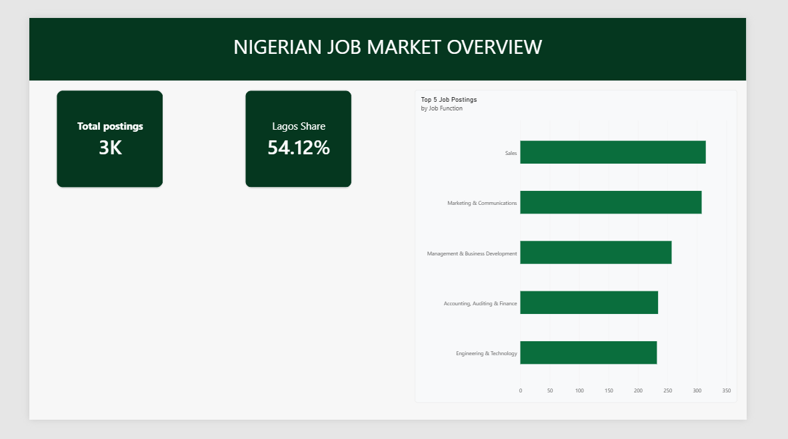
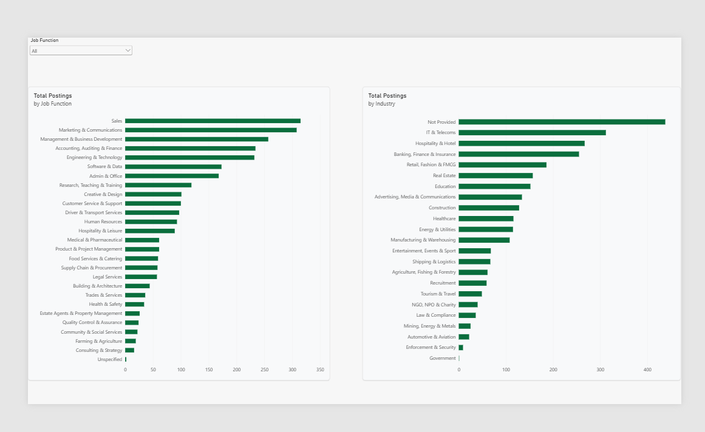
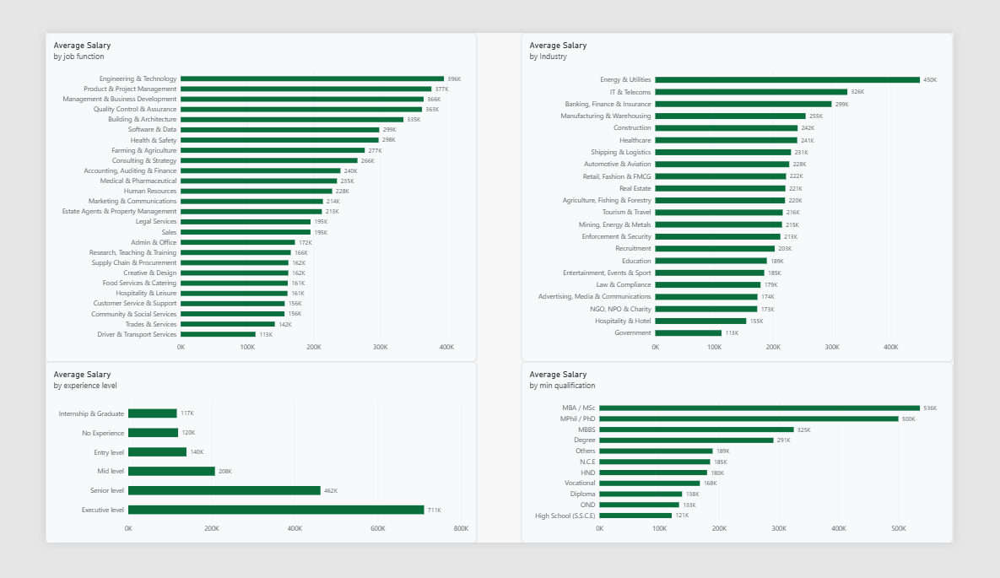
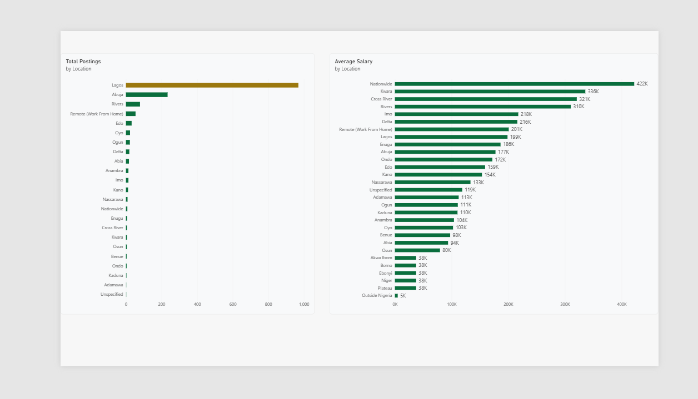

# Nigerian Job Market Analysis

An end-to-end data project exploring what the Nigerian job market looks like through job postings scraped from Jobberman — covering data cleaning, exploratory analysis, SQL, and an interactive Power BI dashboard.

## Project Pipeline
RAW CSV
↓
Python / Pandas
↓
DATA CLEANING
↓
EDA
↓
BUSINESS INSIGHTS
↓
PostgreSQL
↓
SQL
↓
POWER BI
↓
PORTFOLIO DASHBOARD

## Data Source

- **Dataset:** [Jobs-in-Nigeria](https://github.com/pgshandino/Jobs-in-Nigeria) (scraped from Jobberman)
- **Raw file used:** `data/raw/Jobs NG.csv` — 3,264 job postings, 13 columns
- **Limitation:** This dataset is a snapshot of one job board at one point in time. It reflects what was advertised online, not the full Nigerian job market, and no exact scrape date is available from the source.

## Data Cleaning

Starting from 3,264 raw rows, the following issues were identified and fixed:

| Issue | Fix |
|---|---|
| 459 exact duplicate rows (caused by a pinned/promoted listing reappearing on every scraped page) | Removed with `drop_duplicates()` |
| Missing `hiring_firm_url` (664 rows) and `Industry` (444 rows) | Filled with `"Not Provided"` |
| `job_function` had a scrape label prefix (`"Job Function\n:"`) | Stripped, left as the original 27 fixed categories |
| `Location` mixed city+state pairs, "Rest of Nigeria (State)" tags, and non-geographic categories | Standardized to one consistent value per row (mostly state names) |
| `Salary` combined currency, text ranges, and special cases (`Confidential`, `Commission Only`, `Less than X`, `Above X`) in one string | Split into `currency`, `min_salary`, `max_salary`, `salary_type` |
| `details` stored qualification/experience as a stringified list with inconsistent completeness | Split into `min_qualification`, `experience_level`, `experience_length` |
| `date_posted` used relative text (`"2 weeks ago"`) with no confirmed scrape date | Converted to numeric `days_ago` |
| `info` held long unstructured free text (descriptions/requirements) | Dropped — not needed for this analysis |

**Final cleaned dataset:** 2,805 rows × 17 columns → `data/clean/jobs_ng_cleaned.csv`

## Key Findings

**1. Demand vs. Pay are two different stories.**
Sales (315 postings) and Marketing & Communications (308) are the most in-demand job functions — but they only rank mid-table in pay. Engineering & Technology has fewer postings (232) yet the highest average salary (₦396,310), roughly double what Sales pays.

**2. Sales is in demand because it's everywhere, not because one industry drives it.**
Sales postings span 19 of 22 industries in the dataset — no single sector accounts for more than ~15% of them.

**3. Pay rises predictably with experience and qualification.**
Average salary climbs in a clean staircase from Internship & Graduate (₦116,667) to Executive level (₦711,328) — a 6x difference. The same pattern holds for minimum qualification, from High School/SSCE (₦120,833) up to MBA/MSc (₦536,000).

**4. Lagos dominates job volume — but not pay.**
Lagos accounts for ~54% of all postings (1,518 of 2,805), far more than any other location. Yet it ranks only 10th in average pay (₦234,262). Rivers State — home to Port Harcourt and Nigeria's oil & gas sector — has the highest reliable average pay (₦424,209, based on 79 postings), consistent with Energy & Utilities also being the top-paying industry overall.

**5. Energy & Utilities is the best-paying industry.**
₦449,537 average, based on a solid 81 postings — ahead of IT & Telecoms (₦326,312) and Banking, Finance & Insurance (₦299,483).

*Note on reliability: all salary averages are based only on postings in Naira with a complete salary range stated (1,589 of 2,805 jobs). Categories with very few postings behind their average (noted throughout the analysis) should be treated as rough estimates, not firm conclusions.*

## Tech Stack

- **Python / pandas** — data cleaning and exploratory analysis
- **PostgreSQL** — relational database for the cleaned dataset
- **SQL** — business-question queries run directly against PostgreSQL
- **Power BI** — interactive dashboard, connected live to PostgreSQL

## Repository Structure
data/
raw/ → original scraped CSV (untouched)
clean/ → cleaned dataset used for SQL and Power BI
notebooks/
cleaning.ipynb → full data cleaning process, with explanations
eda.ipynb → exploratory analysis and business insights
powerbi/
naijajobs.pbix → the dashboard file
sql/
01_top_job_functions.sql
02_avg_salary_by_job_function.sql
03_avg_salary_by_experience.sql
04_avg_salary_by_industry.sql
05_postings_by_location.sql
06_avg_salary_by_location.sql
07_avg_salary_by_qualification.sql

## Dashboard

The Power BI dashboard has four pages:
- **Overview** — headline numbers (total postings, Lagos's share, top job function)

- **Demand** — most in-demand job functions and industries, with interactive filters

- **Pay** — average salary by job function, industry, experience level, and qualification

- **Location** — job postings vs. average pay by state, side by side

## How to Reproduce

1. Clone this repo
2. Run `notebooks/cleaning.ipynb` to clean the raw data and produce `data/clean/jobs_ng_cleaned.csv`
3. Run `notebooks/eda.ipynb` to reproduce the exploratory analysis
4. Load the cleaned CSV into a local PostgreSQL database named `nigerian_jobs`, in a table called `job_postings`
5. Run the queries in `sql/` against that database
6. Open `powerbi/naijajobs.pbix` in Power BI Desktop (update the database connection to your local credentials)

## Author

**Kosi** — Software Engineering student, Babcock University